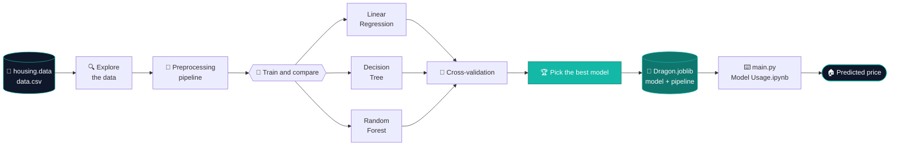
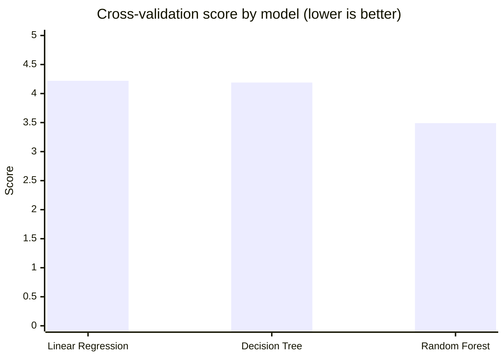

<a id="readme-top"></a>

<div align="center">


### 🏠 Enter 13 property details. Get an estimated house price.

An end-to-end machine learning project that trains, compares, and ships a house price predictor, from raw data to a saved model you can run from the command line.

<br />

[](https://www.python.org/)
[](https://scikit-learn.org/)
[](https://jupyter.org/)
[](#-model-results)
[](https://github.com/Harsh031202/Estate-Price-Pridctor-ML-and-SQL-1/stargazers)

[Overview](#-overview) · [Dataset](#-dataset) · [How It Works](#-how-it-works) · [Results](#-model-results) · [Quick Start](#-quick-start) · [Structure](#-project-structure) · [Roadmap](#-roadmap)

</div>

<br />

---

## ✨ Overview

**Dragon Real Estates** is a regression project that predicts the median value of a home from 13 neighborhood and property attributes. The notebook walks through the full workflow: exploring the data, preparing it, training several models, comparing them with cross-validation, and saving the final model together with its preprocessing pipeline.

Once saved, the model can be used by anyone, with no retraining needed. Run one script, answer 13 prompts, and get a price estimate.

> [!NOTE]
> Prices in this dataset are expressed in **thousands of US dollars**, so a prediction of `24` means roughly **$24,000**.

<br />

## 🚀 Highlights

<table>
<tr>
<td width="50%" valign="top">

### 📓 Full ML Workflow
Data exploration, preprocessing, model training, evaluation, and export, all documented step by step in a Jupyter notebook.

### 🤖 Three Models Compared
**Linear Regression**, **Decision Tree**, and **Random Forest** are evaluated side by side on the same data.

</td>
<td width="50%" valign="top">

### 🧪 Cross-Validated Scoring
Each model is scored with cross-validation, so the comparison is more reliable than a single train/test split.

### 📦 Ready-to-Use Model
The trained model and its preprocessing pipeline are saved together in `Dragon.joblib`, so predictions apply the exact same transformations as training.

### ⌨️ Instant Predictions
Run `main.py`, enter the features, and get a price right in your terminal.

</td>
</tr>
</table>

<br />

## 📊 Dataset

The project uses the classic **Boston Housing** dataset (`housing.data`, with its documentation in `housing.names`). A CSV version is included as `data.csv`. Every row describes one neighborhood using the 13 features below, and the target is the median home value (`MEDV`).

| Feature | Description |
|---------|-------------|
| `CRIM` | Per-capita crime rate by town |
| `ZN` | Share of residential land zoned for lots over 25,000 sq. ft. |
| `INDUS` | Share of non-retail business acres per town |
| `CHAS` | Borders the Charles River (`1`) or not (`0`) |
| `NOX` | Nitric oxide concentration |
| `RM` | Average number of rooms per dwelling |
| `AGE` | Share of owner-occupied units built before 1940 |
| `DIS` | Weighted distance to five employment centres |
| `RAD` | Index of accessibility to radial highways |
| `TAX` | Property-tax rate per $10,000 |
| `PTRATIO` | Pupil-teacher ratio by town |
| `B` | Demographic index (`1000(Bk - 0.63)²`) |
| `LSTAT` | Percentage of lower-status population |
| **`MEDV`** | **Target: median home value, in $1,000s** |

> [!IMPORTANT]
> This dataset is widely used for learning, but the `B` feature encodes a racial-demographics term, and scikit-learn removed its built-in loader over ethical concerns. It is fine for a learning project like this one. It is not appropriate for real-world pricing or lending decisions.

<br />

## 🔬 How It Works



<br />

## 🏆 Model Results

Three models were compared using cross-validation. **Lower is better.**

| Model | Mean score | Std. deviation | |
|-------|:----------:|:--------------:|:-:|
| Linear Regression | 4.22 | 0.75 | |
| Decision Tree | 4.19 | 0.85 | |
| **Random Forest** | **3.49** | **0.76** | 🏆 |



The **Random Forest** gives the lowest error by a clear margin. The raw numbers are in [`Outputs from different models`](Outputs%20from%20different%20models).

<br />

## ⚡ Quick Start

### 1. Clone the repository

```bash
git clone https://github.com/Harsh031202/Estate-Price-Pridctor-ML-and-SQL-1.git
cd Estate-Price-Pridctor-ML-and-SQL-1
```

### 2. Install the dependencies

```bash
pip install numpy pandas scikit-learn joblib matplotlib jupyter
```

> [!TIP]
> `Dragon.joblib` was saved with scikit-learn, so load it with a compatible version. If you see a version warning or error, install the version the model was trained with.

### 3. Predict a price

```bash
python main.py
```

The script asks for the 13 features, in this order:

`CRIM` → `ZN` → `INDUS` → `CHAS` → `NOX` → `RM` → `AGE` → `DIS` → `RAD` → `TAX` → `PTRATIO` → `B` → `LSTAT`

It then applies the saved pipeline and prints the expected price.

<details>
<summary><b>📝 Example input (first record of the dataset)</b></summary>

<br />

| Feature | Value | | Feature | Value |
|---------|------:|-|---------|------:|
| `CRIM` | 0.00632 | | `DIS` | 4.09 |
| `ZN` | 18 | | `RAD` | 1 |
| `INDUS` | 2.31 | | `TAX` | 296 |
| `CHAS` | 0 | | `PTRATIO` | 15.3 |
| `NOX` | 0.538 | | `B` | 396.9 |
| `RM` | 6.575 | | `LSTAT` | 4.98 |
| `AGE` | 65.2 | | | |

The actual median value for this record in the dataset is **24.0** ($24,000).

</details>

### 4. Explore the notebooks

```bash
jupyter notebook
```

| Notebook | What it covers |
|----------|----------------|
| [`Dragon Real Estates.ipynb`](Dragon%20Real%20Estates.ipynb) | The full workflow: exploration, preprocessing, training, and model comparison |
| [`Model Usage.ipynb`](Model%20Usage.ipynb) | Loading the saved model and making predictions |

<br />

## 📁 Project Structure

```text
Estate-Price-Pridctor-ML-and-SQL-1/
├── Dragon Real Estates.ipynb    # End-to-end ML workflow
├── Model Usage.ipynb            # Using the saved model
├── main.py                      # Command-line price predictor
├── Dragon.joblib                # Saved model + preprocessing pipeline
├── data.csv                     # Dataset (CSV)
├── housing.data                 # Original dataset
├── housing.names                # Dataset documentation
└── Outputs from different models   # Cross-validation results
```

<br />

## 🛠️ Tech Stack

<div align="center">


</div>

<br />

## 🗺️ Roadmap

- [x] Train and compare Linear Regression, Decision Tree, and Random Forest
- [x] Save the model and pipeline together with Joblib
- [x] Command-line predictor
- [ ] Add a SQL layer to store the dataset and prediction history
- [ ] Hyperparameter tuning for the Random Forest
- [ ] Simple web interface for predictions
- [ ] `requirements.txt` for one-command setup

<br />

## 🤝 Contributing

Suggestions and improvements are welcome. Found a bug or have an idea? [Open an issue](https://github.com/Harsh031202/Estate-Price-Pridctor-ML-and-SQL-1/issues), or fork the repo and send a pull request.

<br />

## 👤 Author

**DarK** · [@Harsh031202](https://github.com/Harsh031202)

If this project helped you learn something, consider giving it a ⭐.

<br />

<div align="center">


<a href="#readme-top">↑ Back to top</a>

</div>
